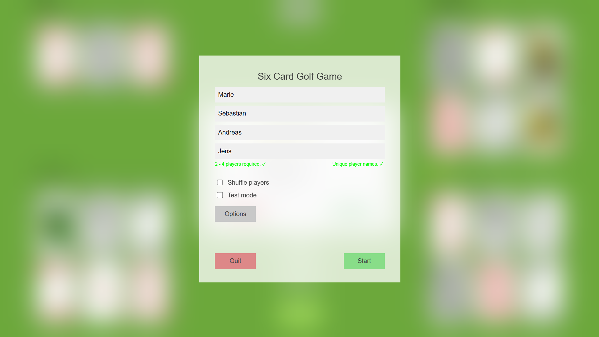
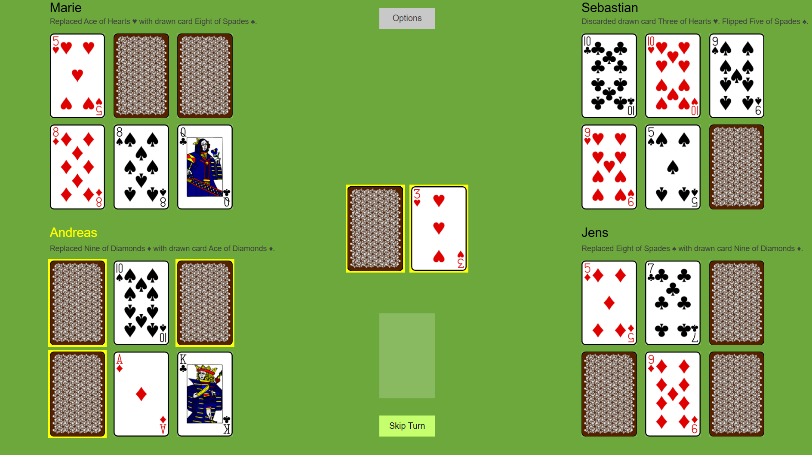
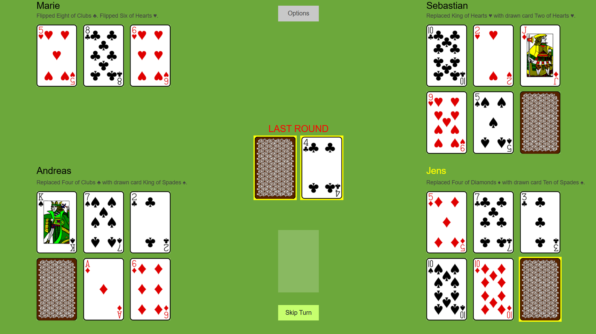

# Six Card Golf
Implementation of the card game Six Card Golf as part of a university software engineering project at TU Dortmund.

## Screenshots

| Main Menu                  | After a few Turns            | Last Turn                    |
|----------------------------|------------------------------|------------------------------|
|  |  |  |

## About the Project
Six Card Golf is a card game in which players try to achieve the lowest possible score by strategically exchanging and revealing cards.
The project was developed as part of the Softwarepraktikum at TU Dortmund.

## My Contribution

I developed the complete implementation independently

My work included:
* Implementation of the game logic
* Implementation of the card and player mechanics
* Development of the graphical user interface using BoardGameWork (BGW)
* Handling of game states and player actions
* Options menu (music toggle, deck design selection)
* Testing and debugging

## Technologies
* Kotlin
* BoardGameWork (BGW)
* Git / GitLab